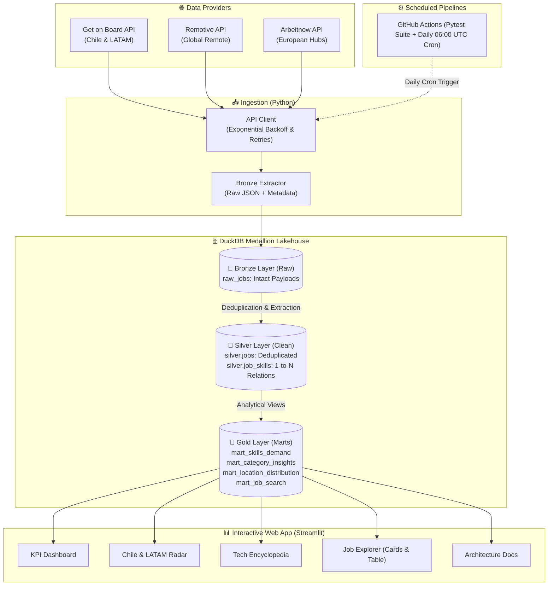
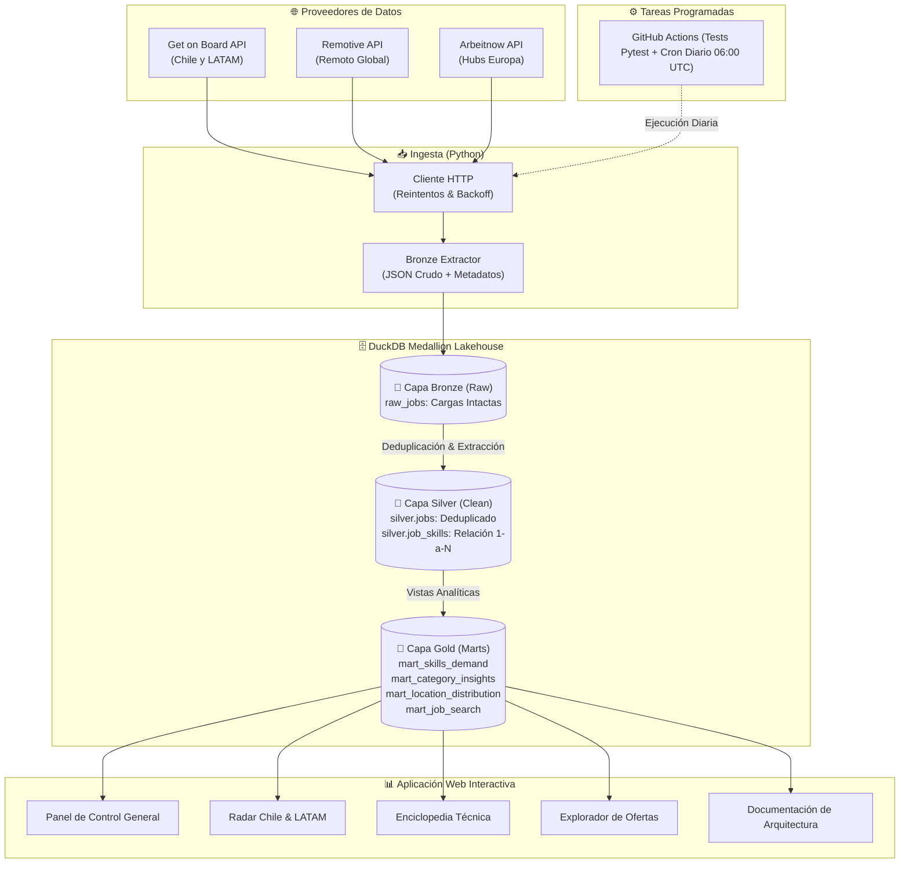

# ⚡ TechPulse: Plataforma Analítica & Pipeline de Datos del Mercado Laboral Tech

[](.github/workflows/ci.yml)
[](https://www.python.org/)
[](https://duckdb.org/)
[](https://streamlit.io/)
[](pytest.ini)
[](https://opensource.org/licenses/MIT)

> **Language / Idioma:** [🇺🇸 English](#-english-version) • [🇪🇸 Versión en Español](#-versión-en-español)

---

<a name="-english-version"></a>
# 🇺🇸 English Version

## 📖 About the Project

The tech job market is highly fragmented. Job postings are scattered across multiple platforms with inconsistent naming conventions, hidden salary data, and varying descriptions. 

**TechPulse** is an automated end-to-end data pipeline and business intelligence platform designed to centralize, standardize, and analyze tech hiring trends. The platform automatically aggregates postings from international and regional APIs, extracts key skills, standardizes salary benchmarks, models the information inside a columnar **DuckDB Lakehouse** using the **Medallion Architecture**, and serves interactive insights through a modern **Streamlit** web application.

---

## 🎯 What Does TechPulse Do?

1. **Multi-Source Ingestion:** Ingests live job postings from multiple job boards:
   - 🇨🇱 **Get on Board API:** Focuses on the Chilean and Latin American tech ecosystem (Santiago, banking, fintech, and regional remote positions).
   - 🌍 **Remotive API:** Aggregates international remote software and data positions with USD salary disclosures.
   - 🇪🇺 **Arbeitnow API:** Captures European tech hubs and hybrid opportunities.
2. **Automated Cleaning & NLP Extraction:**
   - Cleans unstructured HTML text from job descriptions.
   - Employs strict word-boundary regular expressions (`\b`) to detect 30+ programming languages, frameworks, cloud platforms, and data tools without false positives.
   - Standardizes monthly and annual salary formats into a unified annual USD metric.
3. **Columnar Lakehouse Storage (Medallion Pattern):**
   - **Bronze Layer:** Stores immutable raw JSON payloads with UTC ingestion metadata.
   - **Silver Layer:** Structured relational tables (`silver.jobs` and `silver.job_skills`).
   - **Gold Layer:** Pre-computed analytical views serving aggregations with sub-15ms response times.
4. **Interactive Web Application:**
   - Real-time search by role, company, technology, and geography.
   - Dual-view interface: Interactive Job Cards with direct application links, or dense analytical tables.
   - Educational tech catalog detailing why specific technologies (Python, SQL, Cloud, AI) are trending.

---

## 🏛️ Architecture & Data Flow



---

## 🗃️ Data Model

| Layer | Object | Type | Purpose |
| :--- | :--- | :--- | :--- |
| **Bronze** | `bronze.raw_jobs` | Table | Preserves unmodified source payloads, source identifier, and ingestion timestamp. |
| **Silver** | `silver.jobs` | Table | Cleaned job records with normalized country codes (`CL`, `GLOBAL`), sanitized text, and parsed salary ranges. |
| **Silver** | `silver.job_skills` | Table | Relational mapping linking each job to standardized tech skills and categories. |
| **Gold** | `gold.mart_skills_demand` | View | Technology ranking displaying market share percentage and salary correlations. |
| **Gold** | `gold.mart_location_distribution` | View | Distribution across tech hubs, remote modalities, and geographic breakdown. |
| **Gold** | `gold.mart_job_search` | View | Denormalized view optimized for search and filtering queries in the web app. |

---

## 🚀 Setup & Execution Guide

### Prerequisites
* Python 3.12 or 3.13 installed
* Git installed

### 1. Clone the repository
```bash
git clone https://github.com/your-username/techpulse-data-pipeline.git
cd techpulse-data-pipeline
```

### 2. Configure Virtual Environment
```bash
# Windows (PowerShell):
python -m venv .venv
.\.venv\Scripts\activate

# macOS / Linux:
python3 -m venv .venv
source .venv/bin/activate
```

### 3. Install Requirements
```bash
pip install -r requirements.txt
```

### 4. Execute the Data Pipeline
```bash
# Ingests jobs from live APIs and models the DuckDB Lakehouse
python pipeline.py
```

### 5. Launch the Web Application
```bash
streamlit run app/dashboard.py
```
Open your browser at `http://localhost:8501`.

### 6. Run the Unit Test Suite
```bash
pytest -v
```

---
---

<a name="-versión-en-español"></a>
# 🇪🇸 Versión en Español

## 📖 Acerca del Proyecto

El mercado de empleo tecnológico suele estar disperso y desorganizado. Las ofertas se publican en múltiples plataformas independientes, con descripciones heterogéneas, información salarial oculta y sin criterios estándar de clasificación de habilidades.

**TechPulse** es una plataforma y pipeline de datos integral diseñada para centralizar, estructurar y analizar las tendencias de contratación técnica. El sistema extrae periódicamente ofertas desde APIs públicas internacionales y locales, extrae las tecnologías más requeridas, estandariza salarios, modela los datos en un **Data Lakehouse con DuckDB** siguiendo la **Arquitectura Medallion**, y presenta la información de manera interactiva a través de una aplicación web moderna construida con **Streamlit** y **Plotly**.

---

## 🎯 ¿Qué hace TechPulse?

1. **Ingesta Multi-Fuente:** Conecta con diversas plataformas de empleo:
   - 🇨🇱 **API de Get on Board:** Especializada en el mercado de Chile y Latinoamérica (ofertas en Santiago, banca, fintechs y vacantes remotas).
   - 🌍 **API de Remotive:** Puestos remotos internacionales con salarios en USD.
   - 🇪🇺 **API de Arbeitnow:** Hubs tecnológicos europeos y modelos híbridos.
2. **Limpieza Automatizada & Extracción de Habilidades (NLP):**
   - Sanitiza y limpia el código HTML de las descripciones de cargo.
   - Utiliza expresiones regulares con límites de palabra (`\b`) para identificar con precisión más de 30 tecnologías (Python, SQL, Docker, React, AWS, etc.) evitando falsos positivos.
   - Normaliza sueldos mensuales y anuales a una métrica común anual en dólares (USD).
3. **Data Lakehouse en DuckDB (Patrón Medallion):**
   - **Capa Bronze:** Almacena los JSON crudos con marcas de tiempo UTC (`_ingested_at`).
   - **Capa Silver:** Tablas relacionales limpias (`silver.jobs` y `silver.job_skills`).
   - **Capa Gold:** Vistas analíticas precalculadas que responden en menos de 15 milisegundos.
4. **Aplicación Web Interactiva:**
   - Buscador predictivo por rol, empresa, tecnología o país.
   - Modo dual: Vista en **Tarjetas de Empleo** con enlace directo para postular o **Tabla Analítica Clásica**.
   - Enciclopedia técnica que explica por qué cada tecnología es demandada y qué roles la utilizan.

---

## 🏛️ Arquitectura & Flujo de Datos



---

## 🗃️ Modelo de Datos

| Capa | Objeto | Tipo | Propósito |
| :--- | :--- | :--- | :--- |
| **Bronze** | `bronze.raw_jobs` | Tabla | Almacena los registros crudos de las APIs con fuente y marca de tiempo UTC. |
| **Silver** | `silver.jobs` | Tabla | Ofertas deduplicadas con código de país (`CL`, `GLOBAL`), texto limpio y salarios procesados. |
| **Silver** | `silver.job_skills` | Tabla | Relación normalizada que vincula cada oferta de trabajo con sus habilidades tecnológicas. |
| **Gold** | `gold.mart_skills_demand` | Vista | Métricas de penetración de mercado y correlación salarial por tecnología. |
| **Gold** | `gold.mart_location_distribution` | Vista | Distribución geográfica de las ofertas y porcentaje de puestos 100% remotos. |
| **Gold** | `gold.mart_job_search` | Vista | Vista desnormalizada optimizada para el buscador y los filtros de la aplicación web. |

---

## 📂 Estructura del Repositorio

```
├── .github/
│   └── workflows/
│       ├── ci.yml                 # Pruebas automatizadas en cada push (CI)
│       └── scheduled_pipeline.yml # Ejecución diaria programada del pipeline (Cron)
├── .streamlit/
│   └── config.toml                # Configuración de tema visual y estilo
├── app/
│   └── dashboard.py               # Aplicación web analítica interactiva
├── data/
│   ├── raw/                       # Almacenamiento local de instantáneas JSON crudas
│   └── warehouse.duckdb           # Archivo columnar del Lakehouse DuckDB
├── src/
│   ├── ingestion/
│   │   ├── api_client.py          # Cliente HTTP multi-fuente con reintentos automáticos
│   │   └── extractor.py           # Extractor hacia la capa Bronze
│   ├── transformation/
│   │   ├── skill_matcher.py       # Normalizador de habilidades con Regex y parser salarial
│   │   └── warehouse.py           # Modelador del Lakehouse Medallion en DuckDB
│   └── utils/
│       └── logger.py              # Configuración de logs estructurados
├── tests/
│   ├── test_api_client.py         # Tests unitarios con simulación de red (mocking)
│   └── test_skill_matcher.py      # Tests de extracción de habilidades y salarios
├── pipeline.py                    # Script principal de ejecución del pipeline (CLI)
├── requirements.txt               # Lista de dependencias del proyecto
├── pytest.ini                     # Configuración de pruebas Pytest
└── README.md                      # Documentación completa y bilingüe
```

---

## 🚀 Guía de Instalación y Uso (Español)

### 1. Clonar el repositorio
```bash
git clone https://github.com/TU_USUARIO/techpulse-data-pipeline.git
cd techpulse-data-pipeline
```

### 2. Configurar entorno virtual
```bash
# En Windows (PowerShell):
python -m venv .venv
.\.venv\Scripts\activate

# En Linux / macOS:
python3 -m venv .venv
source .venv/bin/activate
```

### 3. Instalar librerías
```bash
pip install -r requirements.txt
```

### 4. Ejecutar el Pipeline de Datos
```bash
# Ingesta las ofertas en vivo y construye el Data Lakehouse en DuckDB
python pipeline.py
```

### 5. Iniciar la Aplicación Web
```bash
streamlit run app/dashboard.py
```
Abre tu navegador en `http://localhost:8501`.

### 6. Ejecutar las Pruebas Unitarias
```bash
pytest -v
```

---

## 📄 Licencia
Este proyecto es de código abierto bajo la [Licencia MIT](https://opensource.org/licenses/MIT). Puedes utilizarlo, adaptarlo y extenderlo libremente.
